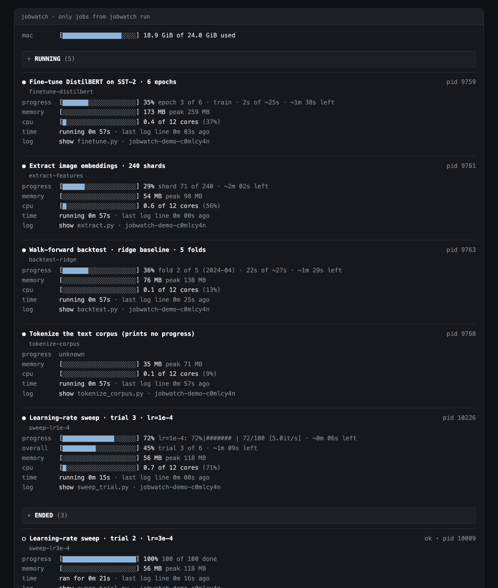
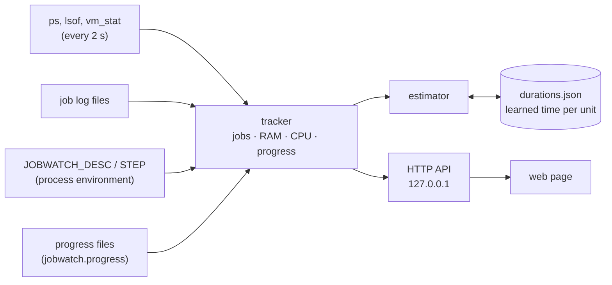

# jobwatch

[](https://github.com/kirazhalim/jobwatch/actions/workflows/test.yml)


**A local dashboard for long-running Python jobs on macOS.** One page shows each job's RAM, CPU, live log, progress, and a **time-left estimate that it learns from earlier runs**.



I run long training jobs, backtests and sweeps in the background, often several at the same time. `top` shows memory but not progress. A log file shows progress but not memory, and a tqdm bar in a log file is hard to read. None of them tells me *how long is left* for a series of 18 jobs. jobwatch puts all of this on one page.

## Features

- **Finds your jobs automatically.** Every Python process that you start shows up. No code change, no wrapper.
- **RAM and CPU of the whole job,** with its child processes (for example data-loader workers), a 30-minute RAM sparkline and the peak.
- **Live log** of each job, in a terminal-style panel.
- **Progress from what your job already prints:** a tqdm bar, `Epoch [3/10]`, `shard 7 of 120`, or your own "item" lines.
- **Time left that improves with each run.** jobwatch measures how long one unit (an epoch, a fold, a trial) takes, and saves it. The next job of the same kind gets an estimate before its first unit ends.
- **Progress of a whole series.** A script that runs 18 jobs one after another sets `JOBWATCH_STEP=11/18`, and the page shows the time left for the whole series.
- **Optional launcher,** `jobwatch run`, that names a job, keeps its log, keeps the Mac awake, records the exit code, and **refuses to start a second memory-heavy job**.
- **Zero dependencies.** Only the Python standard library (3.9 or later) and the tools that every Mac has (`ps`, `lsof`, `vm_stat`).
- **Local and read-only.** The server listens on `127.0.0.1` only. The page cannot start or stop anything.

## Try it in one minute

```bash
git clone https://github.com/kirazhalim/jobwatch.git
cd jobwatch
python3 -m jobwatch demo
```

Then open http://127.0.0.1:8766. The demo starts six fake jobs in a temporary folder: a fine-tune, a backtest, a feature extraction, a learning-rate sweep, a download that fails, and a job that prints no progress. Press Ctrl+C to stop the demo and all its jobs.

## Install

```bash
pipx install git+https://github.com/kirazhalim/jobwatch.git
jobwatch serve            # then open http://127.0.0.1:8765
```

Or run it from the clone without an install: `python3 -m jobwatch serve`.

For a one-click start, run `jobwatch app`. It builds `~/Applications/Jobwatch.app`, which starts the server (if it is off) and opens the page. Drag it to the Dock.

## Tell the page what a job is

jobwatch works with no setup. These environment variables make the page clearer. The page reads them from the running process, so your code does not change.

| Variable | Example | Effect |
|---|---|---|
| `JOBWATCH_DESC` | `"ResNet-50 · lr sweep · run 3"` | The job's title on the page. |
| `JOBWATCH_STEP` | `"11/18 trial"` | This job is number 11 of 18 in a series. The page adds an **overall** bar with the time left for the whole series. Count jobs, not items inside a job. |

```bash
lrs=(1e-3 3e-4 1e-4 3e-5)
for i in "${!lrs[@]}"; do
  JOBWATCH_DESC="lr sweep · lr=${lrs[$i]}" JOBWATCH_STEP="$((i+1))/${#lrs[@]} trial" \
    python train.py --lr "${lrs[$i]}" > "logs/lr${lrs[$i]}.log" 2>&1
done
```

> The page shows the live log of a job only if the job's output goes to a file (`> run.log 2>&1`, `nohup`, or `jobwatch run`). Output to a terminal cannot be read by another process.

## Progress sources

jobwatch uses the first source that it finds for a job:

| Source | What your job does | Example |
|---|---|---|
| Progress file | Calls `jobwatch.progress` (only with `jobwatch run`) | `progress.update(3, 10, unit="epoch", stage="validate")` |
| Item lines | Gets a list of items on its command line and prints one line when each item starts. Needs an `item_rules` entry in the config. | `python bt.py --folds 2024-01 2024-04` and `=== fold 2024-04` |
| tqdm bar | Draws a tqdm bar in its log | `45%\|####5     \| 45/100 [00:10<00:12]` |
| Count line | Prints a count in its last log line | `Epoch [3/10]`, `step 30/200`, `shard 7 of 120` |

`jobwatch/progress.py` has no dependencies. If your job runs in another environment, copy the file into your project. Without `jobwatch run`, its functions do nothing, so the same code runs everywhere.

## The launcher

```bash
jobwatch run --name resnet50-lr3e-4 --desc "ResNet-50 · lr=3e-4" -- python train.py --lr 3e-4
jobwatch list
```

`jobwatch run`:

- writes the log to `~/.jobwatch/logs/`,
- runs the job under `caffeinate`, so the Mac does not sleep,
- sets `PYTHONUNBUFFERED=1`, so the log is always up to date,
- records the exit code, so the page shows **ok** or **failed (exit 1)**, also after a restart,
- **does not start** while another Python job uses more than `heavy_gib` of memory (2 GiB by default). Use `--wait` to wait for it, or `--light` for a small job.

Use `--fg` to wait in the foreground until the job ends.

## Configuration

All settings are optional. Write them in `~/.jobwatch/config.json`:

```json
{
  "heavy_gib": 4,
  "tags": [{"regex": "(?i)proj[-_ ]?(\\d+)", "format": "PROJ-{0}"}],
  "folder_prefixes": ["myrepo-wt-"],
  "name_args": ["--run-name", "--outdir", "--config"],
  "key_args": ["--model"],
  "item_rules": [
    {"arg": "--folds", "start": "^=== fold (?P<item>\\S+)", "skip": "^skip fold (?P<item>\\S+)", "unit": "fold"}
  ]
}
```

| Setting | Meaning |
|---|---|
| `heavy_gib` | A job above this memory is "heavy". The page marks it, and the launcher waits for it. |
| `tags` | Regexes that find a tag, for example a ticket id, in the job's folder, command or log path. |
| `folder_prefixes` | Prefixes to remove from the job's folder name. With git worktrees, `myrepo-wt-lr-sweep` becomes `lr-sweep`. |
| `name_args` | Command-line options whose value names the run. |
| `key_args` | Options that make two jobs of the same script "the same kind" for the learned durations. |
| `item_rules` | Item lines: `arg` is the option with the item list, `start` and `skip` are regexes with an `item` group. |

## How it works



- **Jobs.** A job is a Python process whose parent is not a Python process. Its child processes count as part of it.
- **Logs.** `lsof` gives the file that the job's output goes to. The tracker reads only the new part of the file at each sample.
- **Time left.** For each kind of job (the script name, plus `key_args`), the estimator saves the time of each finished unit. The typical time is the median of the last 20 values. For the unit that runs now:

  ```
  fraction  = min(time in this unit / typical time, 0.95)
  time left = max(typical time × units left − time in this unit,
                  typical time × (units left − 1))
  ```

  The second line makes sure that a unit that is slower than usual does not give a negative time left. If the page did not see when the current unit started (for example, after a restart of the server), it shows no time left instead of a wrong one.

## Limits

- **macOS only.** It reads `ps`, `lsof`, `vm_stat` and `sysctl`. A Linux version would read `/proc` instead.
- **The time left is an estimate.** It assumes that the units of a job take about the same time.
- **Memory is RSS.** Shared memory can be counted more than one time, so the numbers are good for comparing jobs, not exact.
- **Python jobs only.** Other processes do not show up.

## Development

```bash
python3 -m unittest discover -s tests -v
```

The tests use sample `ps`, `lsof` and `vm_stat` output and temporary log files, so they do not depend on the processes of your Mac.

## License

MIT
